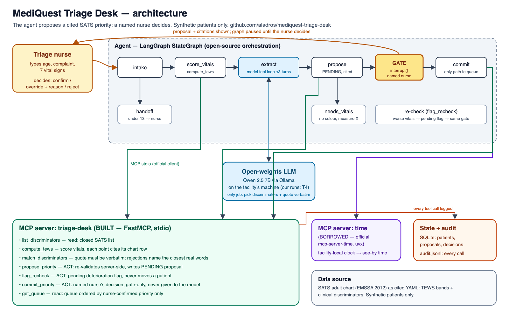

# Architecture

One page. The agent proposes a cited SATS priority; a named nurse decides. Nothing reaches the queue without the nurse's decision.



```
 nurse types: age, complaint, vitals
        │
        ▼
 ┌──────────────────────── LangGraph (src/mediquest_triage_desk/agent.py) ────────────────────────┐
 │ intake ─► score_vitals ─► extract ⇄ match_discriminators ─► propose ─► GATE ─► commit          │
 │   │            │             (model tool loop, ≤3 turns,        │      interrupt()   │          │
 │   ▼            │              retries on rejected quotes)       ▼      named nurse    ▼          │
 │ handoff        │                                           needs_vitals          see-by time   │
 │ (<13 y)        │                                           (no colour)           from clock    │
 └────────────────┼───────────────────────────────────────────────────────────────────┼──────────┘
                  │ MCP (stdio)                                                         │ MCP (stdio)
        ┌─────────▼──────────────────────────────┐                     ┌─────────────────▼─────────┐
        │ triage-desk  (BUILT — server.py)        │                     │ time (BORROWED)           │
        │ list_discriminators   read              │                     │ mcp-server-time,          │
        │ compute_tews          compute           │                     │ modelcontextprotocol/     │
        │ match_discriminators  validate          │                     │ servers                   │
        │ propose_priority      ACT: pending      │                     │ get_current_time          │
        │ flag_recheck          ACT: pending flag │                     └───────────────────────────┘
        │ commit_priority       ACT: gate only    │
        │ get_queue             read              │──► SQLite queue + append-only audit.jsonl
        └─────────────────────────────────────────┘
```

## Agent shape

A fixed plan with one model-driven loop, on purpose. Triage is a protocol, not an open-ended task: the order of
steps (vitals → discriminators → combine → nurse) is the SATS method itself, so the graph encodes it. What can't be
encoded is reading a free-text complaint, and that is the only thing the model does.

- **Model:** open-weights `qwen2.5:7b` via Ollama, on the facility's own machine — no patient text leaves it. Any
  Ollama model can be swapped in with `TRIAGE_MODEL` (EVALS.md compares 7B and 3B). Our own eval and demo runs use a
  Kaggle T4 GPU with synthetic patients only.
- **Model's one job:** call `match_discriminators` with SATS discriminator ids and the exact complaint words that
  support each. The server rejects any id not on the chart and any quote that isn't word-for-word in the complaint, and
  says why — pointing at the closest real words in the complaint. The model reads the rejection and retries (up to 3
  turns). This recovery loop is the agent's self-check.
- **Nothing is dropped silently.** A discriminator the model raised but never managed to cite is passed to the nurse
  as UNVERIFIED ("check with the patient"). It cannot set the colour — it has no source — but she sees it.
- **The colour is never the model's.** `propose_priority` re-scores TEWS and re-validates every quote server-side, then
  takes the higher of the TEWS colour and the discriminator colour (the SATS rule). A model that skips or fakes a step
  cannot get an unsourced colour written down: it simply contributes nothing.
- **Missing vitals:** no colour unless a discriminator already forces orange/red (vitals can only raise a colour).
  Otherwise the agent stops with "measure X first". It never assumes a missing vital is normal.
- **Children:** the adult chart is not applied under 13; the agent hands the patient to the nurse.

## Human gate

`gate` is a LangGraph `interrupt()`. The graph is paused, holding a pending proposal and its citations, until a person
resumes it with their name and a decision: confirm, override (new colour + reason required) or reject (reason
required). Only the `commit` node — downstream of the gate — calls `commit_priority`; the model is never given that
tool. `commit_priority` itself refuses an empty name, an override without a reason, or a proposal already decided.
Deterioration re-checks (`flag_recheck`) raise a pending flag through the same gate; the patient is never moved by
the agent.

## Logging

Every MCP call, from either server, is appended to `var/audit.jsonl` with the caller (`model`, `agent` or `gate`),
inputs, output, timestamp and latency. The triage-desk server also logs its own side of each call. The gate decision is
logged with the nurse's name. The file is append-only; the app never rewrites it.

## Built vs borrowed — and why

| Server | Built/borrowed | Why |
|---|---|---|
| `triage-desk` | **Built** | Nothing exists that scores SATS with per-row citations and a pending/confirmed queue. Its tool boundaries are reusable by any agent: `compute_tews` and `match_discriminators` are general SATS tools, not tied to this graph. |
| `time` (`mcp-server-time`) | **Borrowed** | The see-by deadline written into the audit trail must be correct local time. Timezone rules are maintained upstream; owning tz logic in a clinical log would be a liability, not a feature. |

Orchestration: **LangGraph** (MIT) — needed for `interrupt()` + checkpointing, which is what makes the gate a real pause
and not a prompt asking the model to wait.

## Cost per run

$0 marginal per patient: open-weights model, SQLite, no paid API. Latency per patient on a single T4 GPU (Kaggle) is
reported in EVALS.md — median 1–8 s once the model is loaded; the first call after load takes ~90 s.
